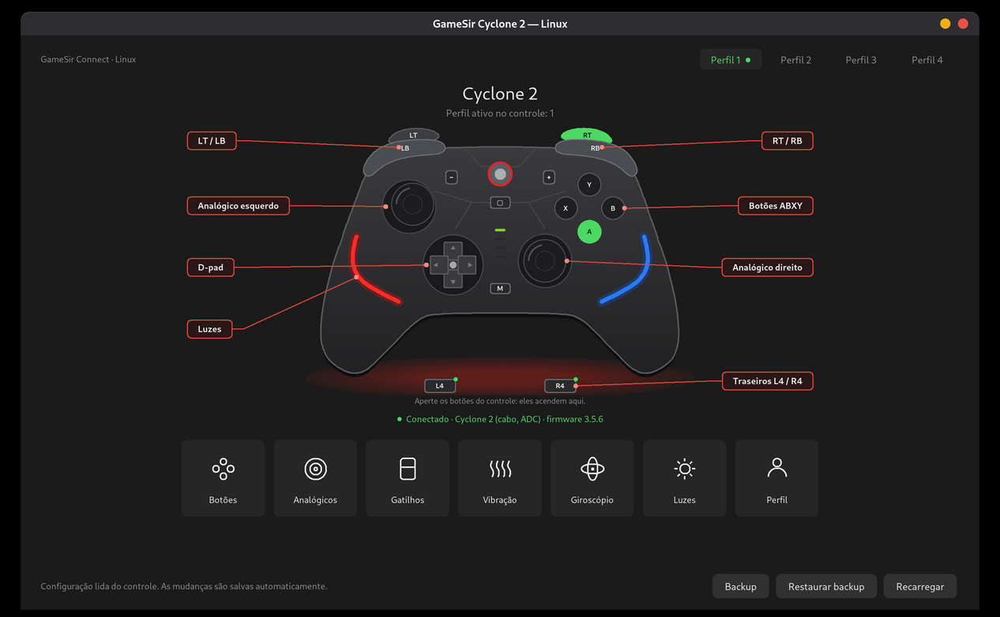
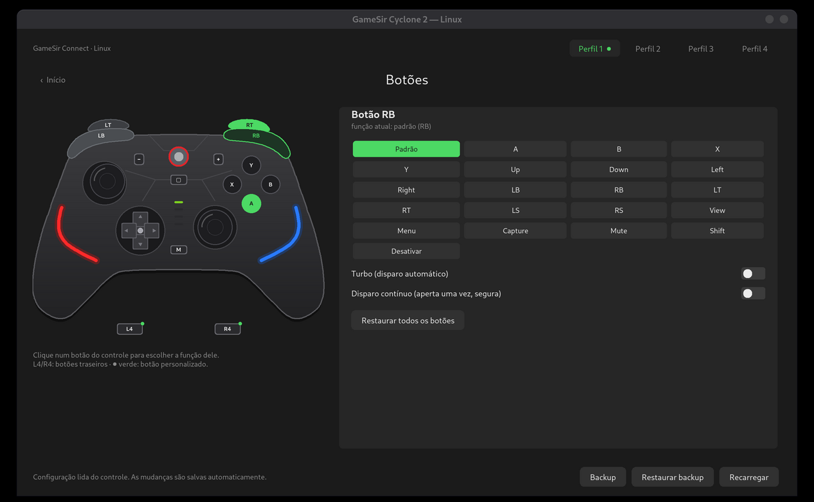
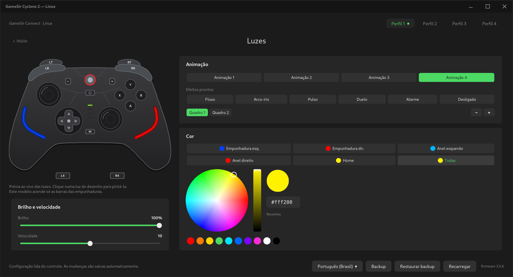

# cyclone2 — GameSir Cyclone 2 configurator for Linux

Open-source replacement for the configuration part of *GameSir Connect*, which only exists for Windows. It talks
to the controller directly over `/dev/hidraw`. You get a command-line tool, `c2ctl`, and a graphical interface,
`c2gui`, in the same style as the [8BitDo Ultimate 2 configurator](https://github.com/MiguelSanzBr/8bitdo-ultimate2-linux).

*Português:* [veja o resumo em português](#português).



| Button remapping | Lighting editor |
|---|---|
|  |  |

> **Not affiliated with GameSir.** "GameSir" and "Cyclone" are trademarks of their owner. The protocol was
> reverse-engineered for interoperability; no code or assets from the official software are included.

## Features

| | `c2ctl` | `c2gui` |
|---|:-:|:-:|
| Firmware version, active profile, battery | ✓ | ✓ |
| 4 profiles: switch, rename, reset to the app's defaults | ✓ | ✓ |
| Button remapping, incl. L4/R4 back buttons, turbo, toggle (up to 3 keys or keyboard/mouse keys via JSON) | ✓ | ✓ |
| Stick dead zone / anti-dead zone, invert axes, raw output | ✓ | ✓ |
| Trigger dead zones and hair trigger (adaptive / fixed) | ✓ | ✓ |
| Motor strength (grips and triggers), rumble test | ✓ | ✓ |
| Gyro: activation (hold / toggle / always), button, output (stick or mouse) | ✓ | ✓ |
| Lighting: 4 animations of up to 8 frames, colours per zone, app presets, brightness, speed, sleep timer | ✓ | ✓ |
| D-pad diagonal lock, ABXY swaps | ✓ | ✓ |
| Macros of the back buttons, curves, report rate (JSON) | ✓ | |
| Backup / restore of every profile and the lighting | ✓ | ✓ |
| Live view of the buttons you press, sticks and analog triggers | ✓ (`watch`) | ✓ |
| Auto-save (changes are written ~0.4 s later and verified) | | ✓ |

Tested with a black Cyclone 2, firmware 3.5.6, over USB (`3537:1053`). The other config modes (`3537:101d`
wired, `3537:102a`/`3537:100b` 2.4G) use the same protocol in the official app but have not been tested yet.

## Install

### Debian / Ubuntu (.deb) — recommended

Download `cyclone2_<version>_all.deb` from the
[Releases page](https://github.com/MiguelSanzBr/gamesir-cyclone2-linux/releases), then:

```bash
sudo apt install ./cyclone2_0.1.0-beta1_all.deb
```

This installs the `c2ctl` and `c2gui` commands, the menu entry "GameSir Cyclone 2" and the udev rule.
Unplug and replug the controller afterwards.

### From source

Requirements: Python ≥ 3.8 and Tk (`python3-tk` on Debian/Ubuntu) for the GUI. There are no other
dependencies.

```bash
git clone https://github.com/MiguelSanzBr/gamesir-cyclone2-linux.git && cd gamesir-cyclone2-linux
sudo cp udev/70-gamesir-cyclone2.rules /etc/udev/rules.d/ && sudo udevadm control --reload && sudo udevadm trigger --action=add --subsystem-match=hidraw
pip install .            # installs the c2ctl and c2gui commands
```

You can also skip installing and run `./c2ctl.py` and `./c2gui.py` straight from the checkout.
Build the `.deb` yourself with `./packaging/build-deb.sh` (output in `dist/`).

> **Beta.** Make a backup first (`c2ctl backup orig.bin`, or the *Backup* button) so you can restore your
> controller's original configuration.

## Usage

### Graphical interface

```bash
c2gui
```

- **Home**: a drawing of your Cyclone 2. Buttons light up when you press them, the triggers fill with the
  pressure and the sticks move. The grip lights preview the current animation, and the indicator under
  Capture shows the active profile. The tiles open each section.
- **Profiles 1–4** are at the top. Selecting one also activates it on the controller, as GameSir Connect
  does; a change made with the controller's own buttons is followed.
- **Buttons**: click a button on the drawing, then choose its new function, turbo or toggle.
- **Lights**: choose an animation or a preset, select a frame, click a light zone (on the drawing or in the
  list) and use the colour wheel. While you are on this page the controller holds the frame being edited.
- **Profile**: name, d-pad and ABXY options, sleep timer, and the drawing colour (black, white or pink).
- Changes are saved automatically. **Backup / Restore backup** save and restore everything.
- The interface is available in English and Brazilian Portuguese. It follows the system language and can be
  changed with the language selector next to **Backup**, or on the **Profile** page (the window restarts).

### Command line

```bash
c2ctl list                          # detected controllers
c2ctl info                          # firmware, mode, active profile, battery
c2ctl backup orig.bin               # every profile + lighting (do this first)
c2ctl dump -p 2 > p2.json           # profile 2 as JSON (default: the active profile)
#  … edit p2.json, or write only the fields you want to change …
c2ctl apply -p 2 p2.json            # writes only what changed and verifies it
c2ctl switch 3                      # make profile 3 active
c2ctl reset --part mapping          # app defaults for the buttons of the active profile
c2ctl light --preset Rainbow        # Flow, Rainbow, Pulse, Standoff, Alarm, Disable
c2ctl light --color '#00ffaa' --brightness 80
c2ctl vibrate --time 0.5
c2ctl watch                         # live input (Ctrl+C to stop)
c2ctl restore orig.bin              # undo everything
```

A partial JSON file is enough for `apply`, for example:

```json
{"buttons": {"L4": {"map": ["A"]}, "R4": {"map": ["KB_SPACE"]}},
 "triggers": {"RT": {"hair_trigger": {"on": true, "mode": 1, "start": 10, "end": 90}}}}
```

Key names are listed in `src/cyclone2/keys.py`. They include the gamepad buttons, stick directions, keyboard
keys (`KB_A`, `KB_SPACE`, …), mouse buttons (`MOUSE_LEFT`, …), `Mute`, `Shift` and `None` (disable). An empty
`map` gives the button its own function back.

## Troubleshooting

- **`permission denied on /dev/hidrawN`**: install the udev rule (see *Install*) and replug the controller. The
  rule must sort before `73-seat-late.rules`, which is why it is called `70-…`.
- **The lights do not change**: on the black edition only the two grip bars light up. The selected animation's
  brightness may also be 0%.
- **`no answer to command …`**: the controller stopped answering. Replug it and try again.

## Development

```bash
python3 -m venv --system-site-packages .venv && .venv/bin/pip install -e ".[test]"
.venv/bin/python -m coverage run -m pytest && .venv/bin/python -m coverage report   # needs an X display for the GUI tests
```

The suite uses an in-process emulator of the controller firmware (`tests/fake_device.py`), seeded with a backup
of a real controller, so no hardware is needed. Coverage is enforced at 100% (lines and branches).

Further reading:

- [docs/PROTOCOL.md](docs/PROTOCOL.md) — the reverse-engineered protocol and the record layouts
- [docs/ARCHITECTURE.md](docs/ARCHITECTURE.md) — how the code is organised
- [CONTRIBUTING.md](CONTRIBUTING.md) and [CHANGELOG.md](CHANGELOG.md)

## Not implemented yet

- Firmware updates.
- Stick and trigger calibration.
- A macro and curve editor in the GUI (both work through JSON).
- The Shift layer in the GUI (`c2ctl dump -p 5` works).
- Confirming the LED zones of the white and pink editions.

## License

[MIT](LICENSE)

---

## Português

Configurador open source do **GameSir Cyclone 2** para Linux, com linha de comando (`c2ctl`) e interface gráfica
(`c2gui`) no mesmo estilo do configurador do 8BitDo Ultimate 2.

As imagens no topo desta página mostram a interface: os botões apertados acendem ao vivo, e há páginas de
botões e de luzes com roda de cores.

- **Instalar**: baixe o `.deb` em [Releases](https://github.com/MiguelSanzBr/gamesir-cyclone2-linux/releases) e rode
  `sudo apt install ./cyclone2_*_all.deb`. Depois reconecte o controle. O app aparece no menu como "GameSir Cyclone 2".
- **Usar**: `c2gui`. As mudanças são salvas sozinhas. Escolher um perfil no topo também o ativa no controle.
- **Idioma**: a interface existe em português (Brasil) e inglês, segue o idioma do sistema e pode ser trocada no
  seletor ao lado do **Backup** ou na página **Perfil** (a janela reinicia).
- **Backup**: `c2ctl backup arquivo.bin` / `c2ctl restore arquivo.bin`.
- Sem vínculo com a GameSir. O protocolo foi obtido por engenharia reversa para interoperabilidade.
